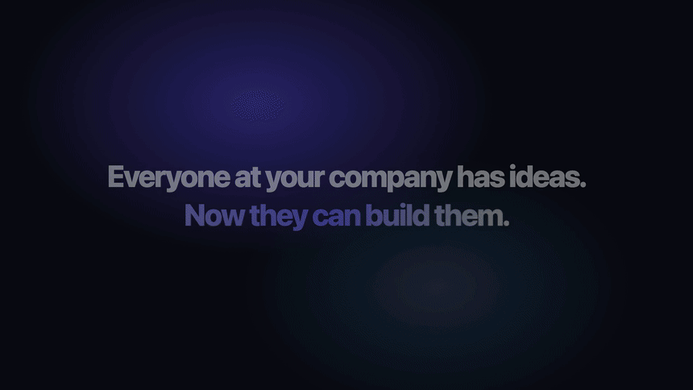
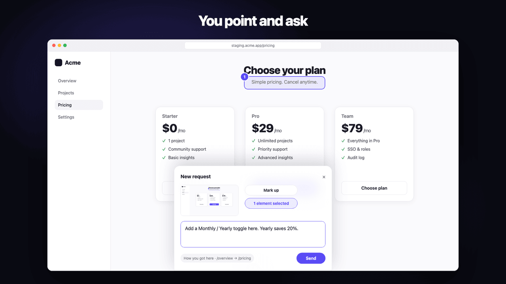
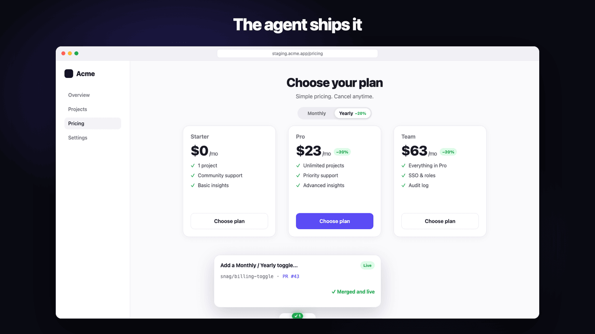
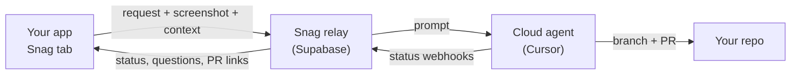

<p align="center">
  
</p>

<h1 align="center">Snag</h1>

<p align="center"><b>Tap the screen, it gets fixed.</b></p>

<p align="center">
  <a href="https://www.npmjs.com/package/@snag-tech/react"></a>
  <a href="https://www.npmjs.com/package/@snag-tech/react"></a>
  
  
  
  <a href="LICENSE"></a>
</p>

<p align="center">
  <a href="assets/snag-demo.mp4"></a>
</p>

Snag lets anyone at your company build in your product. A slim tab at the bottom of every development and staging screen, on web and iOS, lets people ask for what they want right where they want it: a new feature, a whole module, a copy change, or a bug fix. Snag captures the request together with a screenshot and app context, and a multi-tenant relay backend launches an AI coding agent (currently Cursor Cloud Agents) against the project's repository. Status, branch, and PR links show up back inside the app.

<table>
  <tr>
    <th width="50%">You point and ask</th>
    <th width="50%">The agent ships it</th>
  </tr>
  <tr>
    <td></td>
    <td></td>
  </tr>
</table>

## Tap. Describe. Shipped.

| 1. Tap | 2. Describe | 3. Shipped |
|---|---|---|
| A slim tab sits on every internal and staging screen. Hover and it rises to **What's on your mind?** | Ask for a feature, a module, or a fix. Point at where it goes, mark up the screenshot, and say what you want. The route, recent steps and app context ride along. | A cloud agent plans the change and opens a PR. Check the preview from the request card and tap **Looks right**. |

## What people build with Snag

Snag started as a way to report bugs. Now operations, finance and admin teams use it to build features and whole modules. In its first three months, **13 people filed 202 requests, and 93 were merged.**

Real requests, lightly anonymized:

| Area | Asked for |
|------|-----------|
| Finance | A vendor messaging module: admins start a chat with any vendor, send attachments, keep a full message history, and vendors get email notifications |
| Finance | A VAT registration module: a new field on the vendor sign-up form plus an admin review table |
| Finance | A Payment Calendar that groups every scheduled installment by date |
| Finance | A spreadsheet-style payment sheet where edits update the real payment schedules |
| Operations | An ops page: after a customer pays, book a visit over WhatsApp and show a shared calendar of who goes where |
| Operations | Predictive procurement that estimates what the business will need to buy |
| Operations | Change a job's status, asking for a completion date when it's marked completed |
| Admin | Export the jobs list to Excel, with the reason for every cancelled job |
| Admin | Search, filters, sorting and pagination across every list table |
| Support | A fix for notification links that opened a 404 page |

People also use it to understand the product without opening the code: "Why wasn't this job assigned automatically?" or "What happens if I click this?" And they ask for documents, like a bilingual PDF explaining how jobs are assigned, written for management.

Everyone uses the same tab, in English, Arabic or whatever they write in, and every change lands as a reviewable PR.

## Why not just file a ticket?

| | Ticket in Jira or Linear | Snag |
|---|---|---|
| Who can make a change | Engineers | Anyone with access to a staging build |
| Context | Whatever the reporter writes | Screenshot, picked elements, route, recent steps and app context, captured automatically |
| Time to a first version | Waits for a sprint | An agent starts right away |
| Result | A ticket | A branch and a PR, with a preview to check |
| Engineering control | Full | Full: PR-only by default, plus rules, plan review and branch protection |

## Quickstart

Two lines in a React app:

```sh
npm install @snag-tech/react
```

```tsx
import { initSnag, SnagOverlay } from "@snag-tech/react";

initSnag({ endpoint: import.meta.env.VITE_SNAG_ENDPOINT, projectKey: import.meta.env.VITE_SNAG_PROJECT_KEY });

export function App() {
  return (
    <>
      {/* your app */}
      <SnagOverlay />
    </>
  );
}
```

> [!NOTE]
> Leave the env vars unset in production and nothing renders, so it's safe to ship the code in every build. Admins can also turn a project off remotely.

iOS apps use `Snag.start(...)` from SnagKit via Swift Package Manager. Full guides: [React](packages/react/README.md) and [iOS](packages/ios/README.md).

## What people get

- **Select elements**: click the exact things you mean. Each pick carries a selector, text, attributes and, in React dev builds, the component and source file.
- **Attachments**: add images, PDFs, Word and Excel files to a request.
- **Pins**: numbered pins mark open requests on the page, so others see it's already asked for.
- **How you got here**: a short, redacted trail of routes and clicks is attached to every request.
- **Agent questions**: when the agent needs more, the card shows tappable answers.
- **Plan review**: optionally approve the agent's plan in plain language, and preview an approximate version of a visual change on the live page first.
- **Preview, then merge**: open the preview deployment, tap **Looks right**, and Snag merges once CI passes.
- **Follow-ups**: continue any request as a new one, or close it yourself while it's still open.
- **Live status**: the tab glows red when a request needs you, sweeps purple while one is running, and turns green when one is done.

> [!TIP]
> Add `data-testid` to key elements. Production builds strip React's debug info, and test IDs make element picks easy to trace back to code.

## How it works



1. Host app calls `initSnag({ endpoint, projectKey, ... })` and mounts `<SnagOverlay />` at the root.
2. On startup the SDK probes the relay once. The relay reports `{ enabled: true }` only when the project exists and is enabled — the server is the single visibility gate.
3. On button press the SDK captures a screenshot (before the panel opens), the user types the request, and the SDK POSTs it to the relay.
4. The relay stores the request, launches a cloud agent with the prompt, screenshot, and context, and receives status webhooks. The in-app request list shows status, branch, and PR links.

## FAQ

<details>
<summary><b>Does Snag run in production?</b></summary>

No. It is built for development, staging and internal builds. Leave the env vars unset in production and nothing renders. The relay is also the visibility gate: a disabled or deleted project hides the tab everywhere, with no deploy needed.
</details>

<details>
<summary><b>Who reviews the code?</b></summary>

Your engineers, by default. Every request becomes a PR. In execute mode, admins can set rules for what goes straight to implementation, what needs a developer to approve the plan first, and what needs a review before merge. Auto-merge only applies to verified, trusted requesters after CI passes, and branch protection on your repo still has the final say. See [docs/ADMIN.md](docs/ADMIN.md#execute-mode-rules-and-delivery).
</details>

<details>
<summary><b>Which coding agents are supported?</b></summary>

Cursor Cloud Agents today, on GitHub or Cursor Origin repositories. The agent layer sits behind a provider interface, so more agents can be added.
</details>

<details>
<summary><b>Where does my data go?</b></summary>

The request, screenshot and context go to your Snag relay, which passes them to the coding agent working on your repository. The relay stores only whether a screenshot was included, and its logs contain entity IDs, never prompts or screenshots. Keys and tokens are encrypted at rest. Details are in [SECURITY.md](SECURITY.md).
</details>

<details>
<summary><b>Can I self-host it?</b></summary>

Yes. The relay is a set of Supabase Edge Functions and the admin panel is a Next.js app. [docs/OPERATIONS.md](docs/OPERATIONS.md) covers setup, tenants and deployment.
</details>

<details>
<summary><b>Do people need to know how to code?</b></summary>

No. They describe what they want in plain language on the screen where it should happen. When the agent needs more detail, it asks them questions with tappable answers.
</details>

## Roadmap

- [x] React SDK
- [x] iOS SDK (SnagKit)
- [x] Element picking, screenshot markup and attachments
- [x] Execute mode: rules, plan review, preview then merge
- [x] Insights: request volume, funnel, time to ship and hotspots
- [ ] Slack notifications
- [ ] Android SDK
- [ ] More coding agent providers

## Documentation

| Who | Read this |
|-----|-----------|
| **Host app team** (integrating Snag into their React app) | [packages/react/README.md](packages/react/README.md) |
| **Host app team** (integrating Snag into their iOS app) | [packages/ios/README.md](packages/ios/README.md) |
| **Snag admin** (backend, tenants, deploy) | [docs/OPERATIONS.md](docs/OPERATIONS.md) |
| **Admin panel** (web UI for operators and companies) | [docs/ADMIN.md](docs/ADMIN.md) |

## Repo layout

```
snag/
  packages/react/     # @snag-tech/react — web SDK
  packages/ios/       # SnagKit — native iOS SDK (manifest at root Package.swift)
  packages/shared/    # @snag/shared — types, schemas, crypto
  apps/demo/          # Vite playground
  apps/admin/         # Next.js admin panel
  supabase/           # multi-tenant relay
  scripts/            # tenant provisioning (create-project.ts)
  docs/               # operations guide
  marketing/          # demo video source (Remotion), social preview, logo explorations
```

## Demo

```sh
cp apps/demo/.env.example apps/demo/.env
# fill in endpoint + project key (from docs/OPERATIONS.md)
npm install
npm run dev
```

Overlay UI review, with no relay: `npm run dev`, then open [http://localhost:5173/preview](http://localhost:5173/preview). That page renders the request sheet from `packages/react/src` with sample requests. See `.cursor/skills/preview-react-sdk/SKILL.md`.

## Security

> [!WARNING]
> Screenshots capture real screen content. Only enable Snag in environments with non-sensitive or seeded data.

The publishable key (`snag_pk_...`) is public by design, like an analytics write key. Access is limited by a per-project origin allowlist, server-side rate limits and a remote kill switch, and secrets are encrypted at rest. Read [SECURITY.md](SECURITY.md) for the full picture and how to report a vulnerability.

## Contributing

Issues and pull requests are welcome. See [CONTRIBUTING.md](CONTRIBUTING.md) for setup and checks, and the [Code of Conduct](CODE_OF_CONDUCT.md).

## Star history

<a href="https://star-history.com/#OWooody/Snag&Date">
  
</a>
