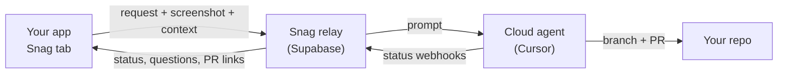

<p align="center">
  
</p>

<h1 align="center">Snag</h1>

<p align="center"><b>Tap the screen, it gets fixed.</b></p>

<p align="center">
  <a href="https://www.npmjs.com/package/@snag-tech/react"></a>
  
  
  <a href="LICENSE"></a>
</p>

<p align="center">
  <a href="assets/snag-demo.mp4"></a>
</p>

Snag lets anyone at your company build in your product. A slim tab at the bottom of every development and staging screen, on web and iOS, lets people ask for what they want right where they want it: a new feature, a whole module, a copy change, or a bug fix. Snag captures the request together with a screenshot and app context, and a multi-tenant relay backend launches an AI coding agent (currently Cursor Cloud Agents) against the project's repository. Status, branch, and PR links show up back inside the app.

## Not just bug reports

Sales adds a CSV export to the leads table. Ops builds a refund approvals queue. Support puts the customer's plan on every ticket. Product ships an onboarding checklist module. QA still files the Safari date picker bug. Everyone uses the same tab, and every change lands as a reviewable PR.

## Tap. Describe. Shipped.

| 1. Tap | 2. Describe | 3. Shipped |
|---|---|---|
| A slim tab sits on every internal and staging screen. Hover and it rises to **What's on your mind?** | Ask for a feature, a module, or a fix. Point at where it goes, mark up the screenshot, and say what you want. The route, recent steps and app context ride along. | A cloud agent plans the change and opens a PR. Check the preview from the request card and tap **Looks right**. |

## Quickstart

Two lines in a React app:

```sh
npm install @snag-tech/react
```

```tsx
import { initSnag, SnagOverlay } from "@snag-tech/react";

initSnag({ endpoint: import.meta.env.VITE_SNAG_ENDPOINT, projectKey: import.meta.env.VITE_SNAG_PROJECT_KEY });

export function App() {
  return (
    <>
      {/* your app */}
      <SnagOverlay />
    </>
  );
}
```

Leave the env vars unset in production and nothing renders. iOS apps use `Snag.start(...)` from SnagKit via Swift Package Manager. Full guides: [React](packages/react/README.md) and [iOS](packages/ios/README.md).

## What people get

- **Select elements**: click the exact things you mean. Each pick carries a selector, text, attributes and, in React dev builds, the component and source file.
- **Pins**: numbered pins mark open requests on the page, so others see it's already asked for.
- **How you got here**: a short, redacted trail of routes and clicks is attached to every request.
- **Agent questions**: when the agent needs more, the card shows tappable answers.
- **Plan review**: optionally approve the agent's plan in plain language, and preview an approximate version of a visual change on the live page first.
- **Preview, then merge**: open the preview deployment, tap **Looks right**, and Snag merges once CI passes.
- **Live status**: the tab glows red when a request needs you, sweeps purple while one is running, and turns green when one is done.

## How it works



1. Host app calls `initSnag({ endpoint, projectKey, ... })` and mounts `<SnagOverlay />` at the root.
2. On startup the SDK probes the relay once. The relay reports `{ enabled: true }` only when the project exists and is enabled — the server is the single visibility gate.
3. On button press the SDK captures a screenshot (before the panel opens), the user types the request, and the SDK POSTs it to the relay.
4. The relay stores the request, launches a cloud agent with the prompt, screenshot, and context, and receives status webhooks. The in-app request list shows status, branch, and PR links.

## Documentation

| Who | Read this |
|-----|-----------|
| **Host app team** (integrating Snag into their React app) | [packages/react/README.md](packages/react/README.md) |
| **Host app team** (integrating Snag into their iOS app) | [packages/ios/README.md](packages/ios/README.md) |
| **Snag admin** (backend, tenants, deploy) | [docs/OPERATIONS.md](docs/OPERATIONS.md) |
| **Admin panel** (web UI for operators and companies) | [docs/ADMIN.md](docs/ADMIN.md) |

## Repo layout

```
snag/
  packages/react/     # @snag-tech/react — web SDK
  packages/ios/       # SnagKit — native iOS SDK (manifest at root Package.swift)
  packages/shared/    # @snag/shared — types, schemas, crypto
  apps/demo/          # Vite playground
  apps/admin/         # Next.js admin panel
  supabase/           # multi-tenant relay
  scripts/            # tenant provisioning (create-project.ts)
  docs/               # operations guide
  marketing/          # demo video source (Remotion), social preview, logo explorations
```

## Demo

```sh
cp apps/demo/.env.example apps/demo/.env
# fill in endpoint + project key (from docs/OPERATIONS.md)
npm install
npm run dev
```

Overlay UI review, with no relay: `npm run dev`, then open [http://localhost:5173/preview](http://localhost:5173/preview). That page renders the request sheet from `packages/react/src` with sample requests. See `.cursor/skills/preview-react-sdk/SKILL.md`.

## Security

- The **publishable key** (`snag_pk_...`) is visible in the JS bundle / app binary — treat it like a Segment write key, not a secret.
- **Origin allowlist** — per-project `allowed_origins`; empty denies all. Web clients are matched by `Origin`/`Referer`; native apps send their bundle ID as `x-snag-app-id` and are matched against `app://<bundle-id>` entries (managed in the admin panel).
- **Rate limits** — per-IP, hourly, and daily caps enforced server-side before launching an agent.
- **Visibility gating** is server-side: disable a project (`enabled = false`) or delete it and the button disappears everywhere.
- **Cursor API keys** are encrypted at rest (AES-256-GCM) with `SNAG_KEY_ENCRYPTION_SECRET`.
- **Screenshots** show real screen content — only enable Snag in environments with non-sensitive/seeded data.
